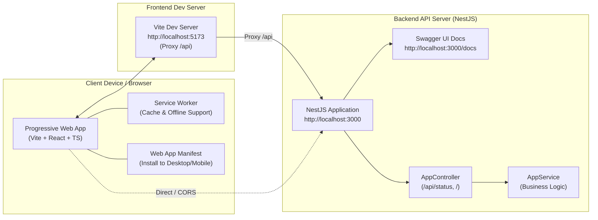

# GEN APHYAH - Fullstack Enterprise Starter Project

Proyek fullstack modern dan terstruktur yang menggabungkan frontend berbasis **Vite (React 19 + TypeScript + PWA)** dan backend berbasis **NestJS (TypeScript)** dengan dokumentasi interaktif **Swagger OpenAPI** serta **End-to-End (E2E) Testing**.

---

## 🏛️ Arsitektur Sistem

Aplikasi ini dirancang dengan pemisahan tanggung jawab (*separation of concerns*) yang jelas antara frontend dan backend:



### 1. Frontend (`/frontend`)
- **Vite & React 19**: Rendering UI reaktif dengan bundling kilat dan Hot Module Replacement (HMR).
- **TypeScript**: Pengecekan tipe statis di seluruh komponen, custom hook, dan service.
- **PWA (Progressive Web App)**: Ditenagai oleh `vite-plugin-pwa` dan Workbox untuk kemampuan offline, caching aset, dan dapat di-install layaknya aplikasi native pada ponsel (Android/iOS) maupun desktop.
- **Arsitektur Modular**: Terbagi dalam folder `components`, `hooks`, `services`, `types`, dan `utils`.
- **E2E Testing**: Dilengkapi suite pengujian alur interaksi pengguna menggunakan **Playwright**.
- **Vite Proxy**: Otomatis meneruskan request `/api` ke backend NestJS di port 3000.

### 2. Backend (`/backend`)
- **NestJS v12**: Framework Node.js berarsitektur enterprise dengan Dependency Injection, Module, dan Controller.
- **Swagger OpenAPI 3.0**: Dokumentasi interaktif siap pakai di **`http://localhost:3000/docs`** (dan `/api/docs`).
- **TypeScript**: Konsistensi tipe bahasa end-to-end dari backend ke frontend.
- **CORS Support**: Konfigurasi Cross-Origin Resource Sharing aktif di `main.ts` agar integrasi API aman dan fleksibel.
- **E2E & Unit Testing**: Ditenagai oleh **Vitest** dan **Supertest** dengan performa eksekusi super cepat.

---

## 📁 Struktur Direktori Monorepo Workspace

```text
GEN_APHYAH/
├── backend/                       # Server NestJS (API, Swagger, Services)
│   ├── src/
│   │   ├── common/                # Shared DTOs, Global Exception Filters
│   │   ├── config/                # Centralized Environment Configuration
│   │   ├── app.controller.ts      # REST Endpoints (/ & /api/status) + Swagger
│   │   ├── app.service.ts         # Business Logic
│   │   ├── app.module.ts          # Root Module
│   │   └── main.ts                # Bootstrap, CORS & Swagger Setup
│   ├── test/                      # E2E Tests (Vitest + Supertest)
│   ├── .gitignore                 # Aturan ignore spesifik backend
│   ├── package.json               # Dependensi & skrip backend
│   └── README.md                  # Dokumentasi teknis backend
│
├── frontend/                      # Client Vite + React + TS + PWA
│   ├── e2e/                       # E2E Tests (Playwright)
│   ├── public/                    # Assets, favicon & ikon PWA (192x192, 512x512)
│   ├── src/
│   │   ├── components/            # Komponen UI reusable (StatusBadge, dll.)
│   │   ├── hooks/                 # Custom Hooks (useNetworkStatus, dll.)
│   │   ├── services/              # API Client (api.ts)
│   │   ├── types/                 # TypeScript Types & Interfaces
│   │   ├── utils/                 # Utility functions & helpers
│   │   ├── App.tsx                # Dashboard interaktif & API tester
│   │   ├── ReloadPrompt.tsx       # Auto-update banner Service Worker
│   │   └── vite-env.d.ts          # Client environment types
│   ├── .gitignore                 # Aturan ignore spesifik frontend
│   ├── playwright.config.ts       # Konfigurasi Playwright
│   ├── package.json               # Dependensi & skrip frontend
│   ├── vite.config.ts             # Konfigurasi Vite & VitePWA
│   └── README.md                  # Dokumentasi teknis frontend
│
├── .vscode/                       # Pengaturan editor VS Code
│   ├── extensions.json            # Rekomendasi ekstensi
│   └── settings.json              # Pengaturan workspace editor
├── .gitignore                     # Aturan ignore global monorepo
├── gen-aphyah.code-workspace      # VS Code Multi-Root Workspace file
├── package.json                   # Root shortcut scripts
└── README.md                      # Dokumentasi utama proyek (file ini)
```

---

## 📋 Prasyarat Sistem

- **Node.js**: Versi `>= 18.0.0` (Sangat disarankan Node 20 LTS atau Node 22)
- **npm**: Versi `>= 9.0.0`
- **Git**: Versi `>= 2.30.0`

---

## 🚀 Panduan Memulai Cepat (Quick Start)

### 1. Instalasi Seluruh Dependensi
Dari direktori root proyek:
```bash
npm run install:all
```

### 2. Menjalankan Backend (Terminal 1)
```bash
npm run dev:backend
```
- Server API: `http://localhost:3000`
- **Dokumentasi Swagger OpenAPI**: **`http://localhost:3000/docs`**

### 3. Menjalankan Frontend (Terminal 2)
```bash
npm run dev:frontend
```
- Web Application: **`http://localhost:5173`**

---

## 📚 Mengakses Dokumentasi Swagger

Dokumentasi interaktif OpenAPI Swagger telah terpasang dan dapat langsung diakses di browser:
👉 **[http://localhost:3000/docs](http://localhost:3000/docs)**
*(Atau via alias path: `http://localhost:3000/api/docs`)*

Di halaman Swagger ini, Anda dapat:
1. Membaca spesifikasi seluruh REST endpoint.
2. Mempelajari struktur request dan response model DTO (`StatusResponseDto`).
3. Menguji eksekusi endpoint secara langsung menggunakan tombol **"Try it out"**.

---

## 🧪 Menjalankan Pengujian (E2E & Unit Tests)

### Pengujian E2E Backend (NestJS + Vitest):
```bash
npm run test:e2e:backend
```
*Menguji endpoint root `/` dan endpoint status `/api/status` secara end-to-end.*

### Pengujian E2E Frontend (Playwright):
```bash
npm run test:e2e:frontend
```
*Menguji rendering komponen halaman utama, badge PWA, dan web manifest.*

### Menjalankan Seluruh E2E Test Sekaligus:
```bash
npm run test:e2e
```

---

## 📜 Ringkasan Perintah NPM

### Perintah Root (`GEN_APHYAH`):
| Perintah | Deskripsi |
| :--- | :--- |
| `npm run install:all` | Menginstal semua dependensi di frontend & backend |
| `npm run dev:frontend` | Menjalankan Vite frontend dev server (`localhost:5173`) |
| `npm run dev:backend` | Menjalankan NestJS backend dev server (`localhost:3000`) |
| `npm run build:frontend` | Build produksi frontend + service worker ke `frontend/dist` |
| `npm run build:backend` | Kompilasi TypeScript backend ke `backend/dist` |
| `npm run test:e2e:backend` | Menjalankan pengujian E2E backend |
| `npm run test:e2e:frontend` | Menjalankan pengujian E2E frontend |
| `npm run test:e2e` | Menjalankan seluruh pengujian E2E backend dan frontend |

### Perintah Khusus Frontend (`cd frontend`):
| Perintah | Deskripsi |
| :--- | :--- |
| `npm run dev` | Menjalankan Vite dev server dengan HMR |
| `npm run build` | Menjalankan type-check dan build produksi |
| `npm run test:e2e` | Menjalankan pengujian Playwright E2E |
| `npm run preview` | Menjalankan server lokal untuk preview folder `dist` |

### Perintah Khusus Backend (`cd backend`):
| Perintah | Deskripsi |
| :--- | :--- |
| `npm run start:dev` | Menjalankan NestJS dalam watch mode |
| `npm run build` | Kompilasi TypeScript ke folder `dist` |
| `npm run test` | Menjalankan unit test dengan Vitest |
| `npm run test:e2e` | Menjalankan integration test E2E |
| `npm run start:prod` | Menjalankan aplikasi hasil build produksi |

---

## 🔗 Dokumentasi Detail Masing-Masing Modul

- ⚡ [Dokumentasi Lengkap Frontend (Vite + PWA)](file:///c:/Users/Rakha/OneDrive/Documents/GEN_APHYAH/frontend/README.md)
- 🦁 [Dokumentasi Lengkap Backend (NestJS + Swagger)](file:///c:/Users/Rakha/OneDrive/Documents/GEN_APHYAH/backend/README.md)
