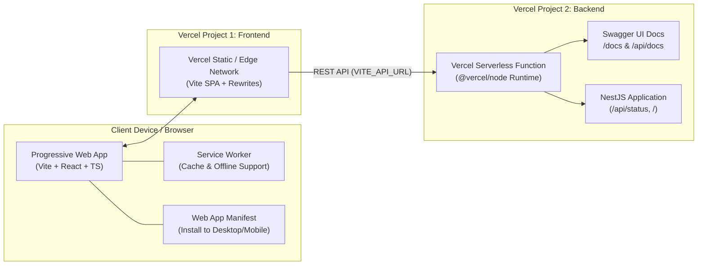

# RUNA Circular Integration (GEN APHYAH)

Aplikasi pengelolaan Bank Sampah RUNA, Desa Cibunian: pencatatan pengumpulan di empat titik, stok material, pengangkutan, Circular Marketplace, pilot Maggot BSF dan paving block, laporan dampak, serta timbangan digital ESP32. Frontend **Vite (React 19 + TypeScript + PWA)**, backend **NestJS + Prisma + PostgreSQL**, dokumentasi API **Swagger**, deploy terpisah ke Vercel.

## ♻️ Menjalankan RUNA di lokal

```bash
npm run install:all
cd backend
cp .env.example .env        # lalu isi JWT_SECRET, IOT_DEVICE_KEY, SEED_ADMIN_PASSWORD
npm run db:dev              # Postgres lokal tanpa Docker (prisma dev); lewati bila sudah punya PostgreSQL
npm run db:migrate          # membuat tabel
npm run seed                # akun "admin", 4 titik pengumpulan, 6 kategori
```

Lalu jalankan `npm run dev:backend` dan `npm run dev:frontend` dari root, buka `http://localhost:5173`, dan login sebagai `admin` dengan `SEED_ADMIN_PASSWORD`.

| Bagian | Lokasi |
| :--- | :--- |
| Skema database & migrasi | `backend/prisma/` |
| Modul API per domain | `backend/src/<domain>/` (daftar endpoint: `http://localhost:3000/docs`) |
| Halaman per modul | `frontend/src/features/` |
| Antrean offline (IndexedDB) & klien API | `frontend/src/services/` |
| Firmware timbangan ESP32 + HX711 | `iot/weighing-scale/` |

**Aturan inti:** stok tidak disimpan sebagai angka total, tetapi dihitung dari ledger `inventory_movements`. Pengumpulan dikirim dengan header `Idempotency-Key`, sehingga kirim ulang dari antrean offline tidak membuat transaksi ganda.

**Tes:** `npm run test:e2e:backend` memakai `TEST_DATABASE_URL` (database terpisah yang isinya dihapus tiap run; `npm run db:test` di folder backend). `npm run test:e2e:frontend` memakai Playwright.

**Deploy backend ke Vercel** butuh environment variable tambahan: `DATABASE_URL` (PostgreSQL ter-host), `JWT_SECRET`, `IOT_DEVICE_KEY`, dan `CORS_ORIGIN` (URL frontend). Jalankan `npm run db:migrate` terhadap database produksi sebelum dipakai.

---

## 🏛️ Arsitektur Sistem

Aplikasi ini dirancang dengan pemisahan tanggung jawab (*separation of concerns*) yang jelas antara frontend dan backend, baik saat dijalankan di lingkungan lokal maupun saat di-deploy ke Vercel secara terpisah:



---

## 📁 Struktur Direktori Monorepo Workspace

```text
GEN_APHYAH/
├── backend/                       # Server NestJS (API, Swagger, Services)
│   ├── src/
│   │   ├── common/                # Shared DTOs, Global Exception Filters
│   │   ├── config/                # Centralized Environment Configuration
│   │   ├── app.controller.ts      # REST Endpoints (/ & /api/status) + Swagger
│   │   ├── app.service.ts         # Business Logic
│   │   ├── app.module.ts          # Root Module
│   │   └── main.ts                # Bootstrap (Standalone & Vercel Serverless Handler)
│   ├── test/                      # E2E Tests (Vitest + Supertest)
│   ├── .env.example               # Contoh konfigurasi environment
│   ├── .gitignore                 # Aturan ignore spesifik backend
│   ├── package.json               # Dependensi & skrip backend
│   ├── vercel.json                # Konfigurasi serverless Vercel (@vercel/node)
│   └── README.md                  # Dokumentasi teknis backend
│
├── frontend/                      # Client Vite + React + TS + PWA
│   ├── e2e/                       # E2E Tests (Playwright)
│   ├── public/                    # Assets, favicon & ikon PWA (192x192, 512x512)
│   ├── src/
│   │   ├── components/            # Komponen UI reusable (StatusBadge, dll.)
│   │   ├── hooks/                 # Custom Hooks (useNetworkStatus, dll.)
│   │   ├── services/              # API Client terpusat (api.ts)
│   │   ├── types/                 # TypeScript Types & Interfaces
│   │   ├── utils/                 # Utility functions & helpers
│   │   ├── App.tsx                # Dashboard interaktif & API tester
│   │   ├── ReloadPrompt.tsx       # Auto-update banner Service Worker
│   │   └── vite-env.d.ts          # Client environment types
│   ├── .env.example               # Contoh konfigurasi environment (VITE_API_URL)
│   ├── .gitignore                 # Aturan ignore spesifik frontend
│   ├── playwright.config.ts       # Konfigurasi Playwright
│   ├── package.json               # Dependensi & skrip frontend
│   ├── vercel.json                # Konfigurasi SPA rewrite Vercel
│   ├── vite.config.ts             # Konfigurasi Vite & VitePWA
│   └── README.md                  # Dokumentasi teknis frontend
│
├── .vscode/                       # Pengaturan editor VS Code
│   ├── extensions.json            # Rekomendasi ekstensi
│   └── settings.json              # Pengaturan workspace editor
├── .gitignore                     # Aturan ignore global monorepo
├── gen-aphyah.code-workspace      # VS Code Multi-Root Workspace file
├── package.json                   # Root shortcut scripts
└── README.md                      # Dokumentasi utama proyek (file ini)
```

---

## 📋 Prasyarat Sistem

- **Node.js**: Versi `>= 18.0.0` (Sangat disarankan Node 20 LTS atau Node 22)
- **npm**: Versi `>= 9.0.0`
- **Git**: Versi `>= 2.30.0`

---

## 🚀 Panduan Menjalankan di Lokal (Quick Start)

### 1. Instalasi Seluruh Dependensi
```bash
npm run install:all
```

### 2. Menjalankan Backend (Terminal 1)
```bash
npm run dev:backend
```
- Server API: `http://localhost:3000`
- **Dokumentasi Swagger OpenAPI**: **`http://localhost:3000/docs`**

### 3. Menjalankan Frontend (Terminal 2)
```bash
npm run dev:frontend
```
- Web Application: **`http://localhost:5173`**

---

## ☁️ Panduan Deploy ke Vercel Secara Terpisah

Karena struktur repositori adalah monorepo (`frontend/` dan `backend/`), Anda dapat membuat **2 Proyek Terpisah di Vercel** dari satu repository GitHub yang sama:

### Langkah 1: Deploy Backend Terlebih Dahulu (Proyek 1 di Vercel)
1. Buka [Vercel Dashboard](https://vercel.com/) -> **Add New...** -> **Project**.
2. Pilih repository: **`Couraa0/GEN_APHYAH`**.
3. Di bagian **Root Directory**, klik **Edit** dan pilih folder **`backend`**.
4. Vercel akan otomatis mengenali konfigurasi [`backend/vercel.json`](file:///c:/Users/Rakha/OneDrive/Documents/GEN_APHYAH/backend/vercel.json).
5. Pada bagian **Environment Variables**, tambahkan:
   - `NODE_ENV` = `production`
6. Klik **Deploy**.
7. Salin URL backend yang dihasilkan (contoh: `https://gen-aphyah-backend.vercel.app`).
   - Uji API: `https://gen-aphyah-backend.vercel.app/api/status`
   - Uji Swagger: `https://gen-aphyah-backend.vercel.app/docs`

---

### Langkah 2: Deploy Frontend (Proyek 2 di Vercel)
1. Kembali ke [Vercel Dashboard](https://vercel.com/) -> **Add New...** -> **Project**.
2. Pilih kembali repository yang sama: **`Couraa0/GEN_APHYAH`**.
3. Di bagian **Root Directory**, klik **Edit** dan pilih folder **`frontend`**.
4. Pengaturan Build:
   - **Framework Preset**: `Vite` (otomatis)
   - **Build Command**: `npm run build`
   - **Output Directory**: `dist`
5. Pada bagian **Environment Variables**, tambahkan URL backend dari Langkah 1:
   - `VITE_API_URL` = `https://gen-aphyah-backend.vercel.app` *(gunakan URL backend Anda)*
6. Klik **Deploy**.
7. Frontend PWA Anda kini aktif di URL Vercel (contoh: `https://gen-aphyah-frontend.vercel.app`) dan terhubung langsung ke backend serverless!

---

## 🧪 Menjalankan Pengujian (E2E & Unit Tests)

### Pengujian E2E Backend (NestJS + Vitest):
```bash
npm run test:e2e:backend
```

### Pengujian E2E Frontend (Playwright):
```bash
npm run test:e2e:frontend
```

### Menjalankan Seluruh E2E Test:
```bash
npm run test:e2e
```

---

## 📜 Ringkasan Perintah NPM

| Perintah | Deskripsi |
| :--- | :--- |
| `npm run install:all` | Menginstal semua dependensi di frontend & backend |
| `npm run dev:frontend` | Menjalankan Vite dev server (`localhost:5173`) |
| `npm run dev:backend` | Menjalankan NestJS dev server (`localhost:3000`) |
| `npm run build:frontend` | Build produksi frontend + Service Worker |
| `npm run build:backend` | Kompilasi TypeScript backend |
| `npm run test:e2e:backend` | Menjalankan pengujian E2E backend |
| `npm run test:e2e:frontend` | Menjalankan pengujian E2E frontend |
| `npm run test:e2e` | Menjalankan seluruh pengujian E2E |

---

## 🔗 Dokumentasi Detail Masing-Masing Modul

- ⚡ [Dokumentasi Lengkap Frontend (Vite + PWA + Vercel)](file:///c:/Users/Rakha/OneDrive/Documents/GEN_APHYAH/frontend/README.md)
- 🦁 [Dokumentasi Lengkap Backend (NestJS + Swagger + Vercel)](file:///c:/Users/Rakha/OneDrive/Documents/GEN_APHYAH/backend/README.md)
